# 魚塭資料與管理後端

接收 ESP32 感測資料，管理魚池、裝置與每日作業紀錄，並為魚塭前端提供登入、通知、Grafana 和 AI 助理轉接 API。後端以 Express 和 PostgreSQL 組成，AI 對話與預測模型則由外部服務處理。

這個倉庫提供 API 與整合邏輯，並不包含 ESP32 韌體、完整前端、Grafana、RAG 模型或 MQTT broker。部署時需要分別準備這些服務。

## 目錄

- [功能與系統架構](#功能與系統架構)
- [環境需求](#環境需求)
- [快速開始](#快速開始)
- [設定說明](#設定說明)
- [API 與身分驗證](#api-與身分驗證)
- [通知與外部服務](#通知與外部服務)
- [目錄與資料維護](#目錄與資料維護)
- [驗證與常見問題](#驗證與常見問題)

## 功能與系統架構

| 功能 | 責任 |
|---|---|
| 感測上報 | 量測資料、維護紀錄與 crash report，保留 v1 接收入口 |
| 魚池管理 | 魚池與感測器資料、最新讀值與每日作業紀錄 |
| 登入 | 網頁使用者登入、註冊與 JWT |
| 預測整合 | 連到模型回應服務，同步預測結果與歷史回補 |
| AI 轉接 | 核對魚池權限、簽發 AI Helper 身分並轉送對話和 SSE |
| Grafana | 登入橋接、代理與告警 webhook |
| Web Push | 訂閱、告警入列、通知傳送與排程 |



圖源：[architecture.mmd](docs/architecture.mmd)。即時感測、預測結果和 AI 回答是不同資料來源，不能把模型回覆當作量測值。

## 環境需求

- Node.js 與 npm；本套件是 ESM，沒有宣告統一最低 Node 版本。
- PostgreSQL，開發者建立資料庫時需 `createdb` 和 `psql`。
- 如需 AI 對話，準備可存取的 `rag-ai-helper`。
- 如需預測同步，準備模型回應服務。
- 如需歷史圖表及推播，準備 Grafana、VAPID 金鑰與可用的 HTTPS 網站。

## 快速開始

從倉庫根目錄安裝：

```powershell
npm ci
```

先執行 `Copy-Item example.env .env`，再填入自己的設定。本機 API 預設 port 是 `3002`，沒有統一 `/api` 前綴：

```dotenv
NODE_ENV=development
SERVER_PORT=3002
DATABASE_URL=127.0.0.1
DATABASE_PORT_RW=5432
DATABASE_PORT_RO=5432
DATABASE_NAME=fish_dev
DATABASE_USER=your_database_user
DATABASE_PASSWORD=replace_with_local_password
WEB_JWT_SECRET=replace_with_random_web_secret
SENSOR_JWT_SECRET=replace_with_random_sensor_secret
AI_HELPER_BASE_URL=http://127.0.0.1:8000
PREDICTION_SYNC_ENABLED=false
```

預測服務未就緒時，先關閉同步，避免把啟動重試當成服務已正常。Web Push 和 Grafana 則需另外補上設定。

### 建立測試 schema

`build/SQL/buildDB.sql` 開頭會刪除既有資料表，**只供全新且可重建的測試資料庫**。實際資料庫應先備份，再依目前 schema 選擇增量 SQL。

```powershell
createdb -h 127.0.0.1 -p 5432 -U postgres fish_dev
psql -h 127.0.0.1 -p 5432 -U postgres -d fish_dev -v ON_ERROR_STOP=1 -f build/SQL/buildDB.sql
node index.js
```

建立資料庫的 `postgres` 帳號僅為本機示例，應替換成有權限的帳號，並授予應用程式使用者相應權限。啟動後要確認資料庫成功連線的日誌，不能只確認 port 已監聽。

## 設定說明

| 設定 | 用途 |
|---|---|
| `DATABASE_*` | 主資料庫帳密，以及讀寫／唯讀兩個 pool 的 port |
| `WEB_JWT_SECRET`、`SENSOR_JWT_SECRET` | 網頁與裝置分開驗證，token 不應互換 |
| `AI_HELPER_BASE_URL`、`AI_HELPER_TIMEOUT_MS` | RAG 服務來源與逾時 |
| `AI_HELPER_JWT_EXPIRES_IN` | 轉送至 AI Helper 的身分有效期 |
| `MODEL_RESPONSE_SERVICE_URL`、`MODEL_RESPONSE_TIMEOUT_MS` | 外部預測服務 |
| `PREDICTION_SYNC_ENABLED`、`PREDICTION_SYNC_INTERVAL_MS` | 預測同步啟用與執行間隔 |
| `PREDICTION_LOOKBACK_HOURS`、`PREDICTION_BACKFILL_*` | 預測查詢及回補範圍 |
| `GRAFANA_URL`、`GRAFANA_BRIDGE_SECRET` | Grafana 代理來源與登入橋接 |
| `GRAFANA_WEBHOOK_TOKEN` | 告警接收的可選驗證值 |
| `VAPID_PUBLIC_KEY`、`VAPID_PRIVATE_KEY`、`VAPID_CONTACT` | Web Push 身分與聯絡資訊 |
| `NOTIFICATION_OUTBOX_*` | 通知佇列批次與執行間隔 |
| `WEATHER_API_KEY` | 外部天氣服務憑證 |

production 的資料庫連線目前有略過憑證驗證的設定，不能據此宣稱已完成 TLS 信任驗收。RO／RW 的不同 port 只代表連線可分開設定，不代表已建立高可用叢集。

## API 與身分驗證

| 入口 | 用途 | 身分 |
|---|---|---|
| `/web_auth` | 登入、註冊與 Grafana bootstrap | 依各個路由 |
| `/web` | 魚池、裝置、作業紀錄、AI 與通知 | `jwt-web` |
| `/sensors` | 感測、維護與 crash report | `jwt-sensor` |
| `/webhook/grafana` | 告警接收 | 依 webhook token 設定 |
| `/grafana` | Grafana 代理 | Bridge 身分 |

感測上報入口包括 `POST /sensors/include`、`POST /sensors/v1/include`、`POST /sensors/maintainRecord` 和 `POST /sensors/crashReport`。主路由沒有掛載 `/shared`，`/web/access` 也已卸載，不能只看到檔案存在就將它們視為公開 API。

完整參數請看 [API 文件](docs/api-documentation.md)，舊介面保留在 [deprecated-features.md](docs/deprecated-features.md)。如果前端以 `/api/web/...` 存取，需由反向代理把 `/api` 前綴轉成後端實際路徑，或將前端 API base 直接設成 `http://localhost:3002`。

## 通知與外部服務

Grafana webhook 將告警轉成使用者通知，應先確認 `user_id`／`pond_id` 的來源、冷卻時間與恢復通知設定，再參考 [告警文件](docs/grafana-webhook.md) 配置測試規則。Notification outbox 入列和瀏覽器真的收到推播是兩個驗證階段。

Web Push 需要前端註冊 service worker、訂閱資料、對應 VAPID 公鑰與有效 server 私鑰。不要將 VAPID 私鑰放入前端 `VITE_*`。

AI 轉接會使用魚池權限與 JWT，AI Helper 的 `WEB_JWT_SECRET` 必須與簽發端相容。SSE 經過反向代理時要確認 buffering、連線逾時和錯誤事件，避免後端已串流但前端一次才收到全部內容。

## 目錄與資料維護

| 路徑 | 責任 |
|---|---|
| [index.js](index.js) | Express 初始化、資料庫重試、代理與排程 |
| [routes/sensors](routes/sensors) | 裝置上報與回報 |
| [routes/web](routes/web) | 網頁 API 與 AI 代理 |
| [routes/webhook](routes/webhook) | Grafana webhook |
| [SQL_Controller](SQL_Controller) | 主資料庫查詢與資料保存 |
| [methods](methods) | 身分、AI、模型回應、通知與其他共用功能 |
| [cron](cron) | 清理、預測同步與通知工作 |
| [build/SQL](build/SQL) | 建表、欄位更新、範例與 seed |
| [config/app-config.json](config/app-config.json) | 專案的額外設定 |

備份 PostgreSQL 資料、schema 與所需外部設定；還原後重新核對 JWT、VAPID 和通知訂閱。`testdata.sql`、資料匯出與開發帳密不能當作正式資料的來源。

## 驗證與常見問題

```powershell
node --check index.js
```

套件沒有宣告 `npm test` 或 `npm start`，啟動入口是 `node index.js`。語法檢查只能檢查 JavaScript，SQL parse 也不能取代 migration 測試。

整合驗收依序確認：登入與 token-check、魚池資料權限、裝置量測入庫、每日紀錄、AI SSE、告警入列、推播送達、預測同步和斷線重試。

| 現象 | 檢查 |
|---|---|
| 不斷重試 PostgreSQL | 帳密、host、兩個 port、database、SSL 與資料表 |
| 前端 API 404 | `/api` 前綴是否由代理處理，API base 是否對應 `3002` |
| 量測 401 | 是否使用 sensor JWT，而非 web JWT |
| AI 502／504 | AI Helper 的位置、逾時、JWT、資料庫與模型服務 |
| Grafana iframe 無法開啟 | Bridge cookie、proxy 路徑、Grafana 設定與 HTTPS |
| 通知已入列但沒送達 | VAPID、訂閱、outbox、瀏覽器權限和 service worker |
| 啟動就出現預測錯誤 | 模型服務是否就緒，是否需要先停用同步 |

本文件描述目前掛載的功能與操作方式，沒有宣稱正式部署、推播到達或真實模型預測已通過。

## 專案倉庫

本倉庫：[Du121793/pond-monitoring-api](https://github.com/Du121793/pond-monitoring-api)。

這個元件屬於魚塭監控與控制系統，各服務獨立部署，透過 API 或設備通訊整合。

| 元件 | 責任 |
|---|---|
| [water-quality-sensing](https://github.com/Du121793/water-quality-sensing) | ESP32 水質感測與量測上傳 |
| [remote-relay-control](https://github.com/Du121793/remote-relay-control) | STM32 遠端繼電器與設備控制 |
| [pond-monitoring-api](https://github.com/Du121793/pond-monitoring-api) | 魚池資料、權限與告警 API |
| [water-quality-rag](https://github.com/Du121793/water-quality-rag) | 水質論文 RAG 與魚池資料問答 |
| 魚塭前端 | 監控介面與管理操作，發布網址待確認 |

## 本機私有設定

公開倉庫只提供範例設定。實際 `.env`、API token、Wi-Fi 密碼、裝置金鑰和私有設定檔保留在本機，範例占位值必須換成自己的設定才能使用相應服務。
